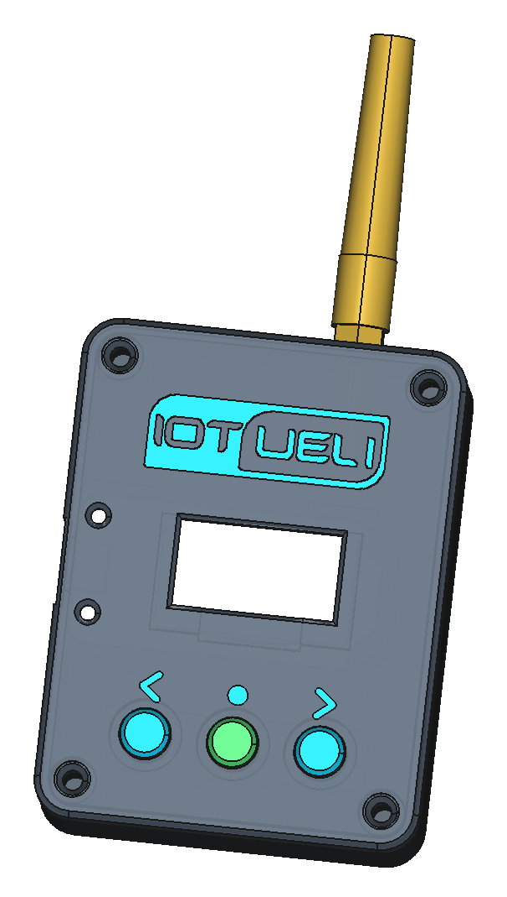
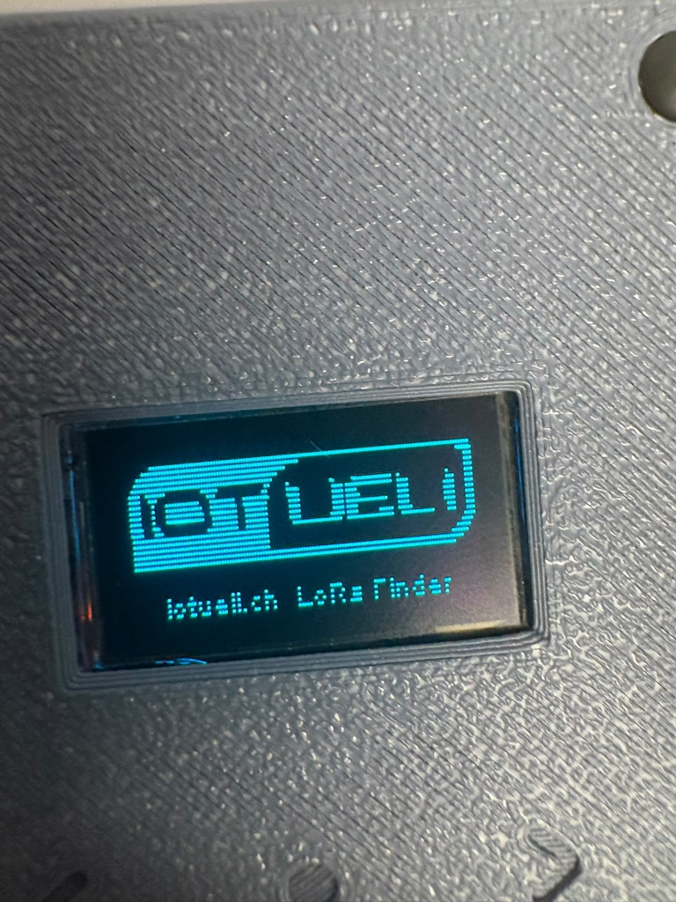
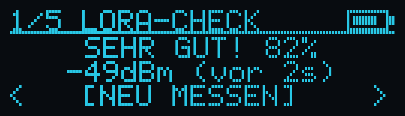
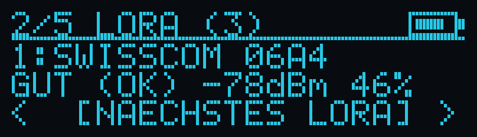
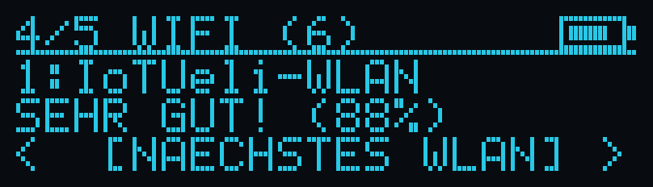
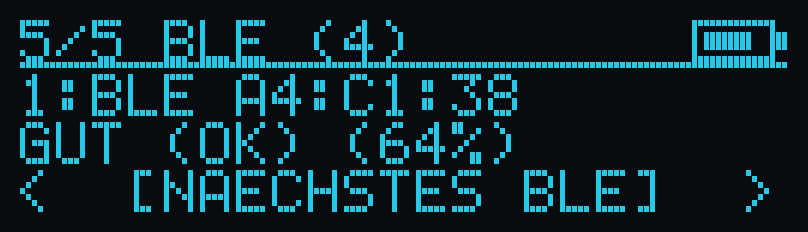

# 3-in-1 LoRaWAN / WiFi / BLE Finder

Tragbarer Scanner für 868 MHz LoRaWAN (Swisscom, TTN, Dragino, Helium), 2.4 GHz WLAN und Bluetooth BLE auf Basis des Heltec WiFi LoRa 32 V2.

Projekt: [www.iotueli.ch](https://www.iotueli.ch)

<p align="center">
  
  
</p>

## Inhalt

| Pfad | Beschreibung |
| :--- | :--- |
| [`Bauanleitung_LoRaWAN_Finder.pdf`](Bauanleitung_LoRaWAN_Finder.pdf) | Bau- und Bedienungsanleitung (Stückliste, Schaltplan, Montage, Bedienung) |
| [`cad/export/LoraWanFinder_BambuLab_Platte.3mf`](cad/export/LoraWanFinder_BambuLab_Platte.3mf) | Zweifarbige Bambu-Studio-Druckplatte (ohne Support) |
| [`cad/export/`](cad/export/) | Einzelne STL-Dateien: Gehaeuse_Unten, Gehaeuse_Oben, Logo_und_Tasten_Farbe2, Taster_Kappe (3x) |
| [`src/main.cpp`](src/main.cpp), [`include/`](include/), [`platformio.ini`](platformio.ini) | Firmware (PlatformIO) |

## Stückliste

| Anz. | Bauteil |
| :---: | :--- |
| 1 | Heltec WiFi LoRa 32 V2 |
| 1 | SMA-Einbaubuchse mit U.FL-Kabel und 868 MHz Antenne |
| 3 | Kurzhubtaster 6x6 mm (4 Pins) |
| 4 | M3 Einschmelzgewinde (Aussen-Durchmesser 4.0 mm) |
| 4 | M3 x 8 mm Schrauben |
| 1 | Optional: 1S LiPo-Akku (JST 1.25 mm) und Schiebeschalter |

## Tasteranschluss

Pro Taster werden nur zwei diagonal gegenüberliegende Pins benötigt:

| Taster | Pin 1 | Pin 4 |
| :--- | :--- | :--- |
| Links `‹` | GND | GPIO 12 |
| Mitte `●` | GND | GPIO 13 |
| Rechts `›` | GND | GPIO 32 |

## Bedienung

Links und Rechts blättern durch die 5 Seiten, Mitte startet die in `[...]` angezeigte Aktion.

1. LORA-CHECK: Signalstärke des letzten LoRa-Pakets (Prozent, dBm)
2. LORA (n): Liste der empfangenen LoRaWAN-Netze und Sender
3. LORA-TEST: Sendet Testpakete an ein Gateway
4. WIFI (n): WLAN-Scanner
5. BLE (n): Bluetooth-BLE-Scanner

### Display

Startbild (Foto des Geräts):



Die 5 Seiten (Darstellung der Anzeige):

| Seite | Anzeige |
| :--- | :--- |
| 1 LORA-CHECK |  |
| 2 LORA (n) |  |
| 3 LORA-TEST |  |
| 4 WIFI (n) |  |
| 5 BLE (n) |  |

## Firmware flashen

```bash
pio run -t upload
```
