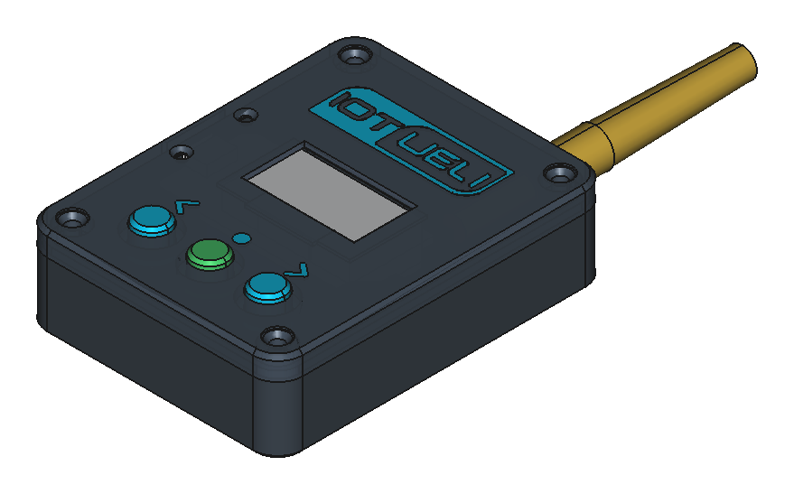
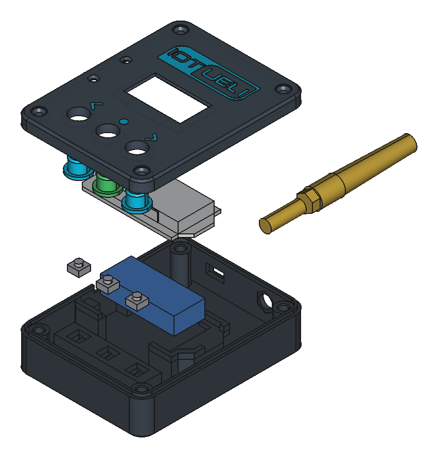
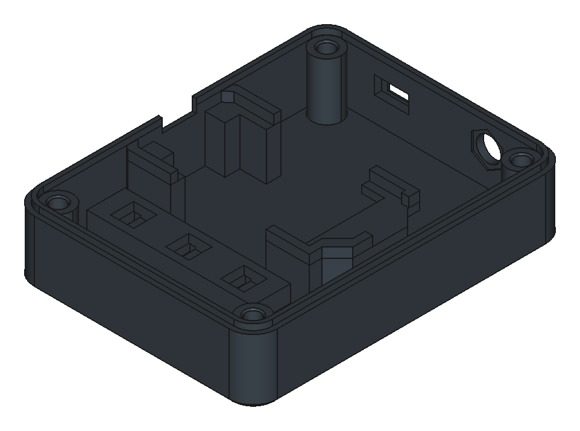
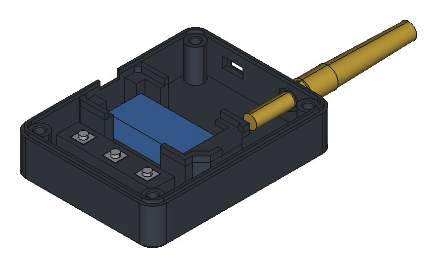
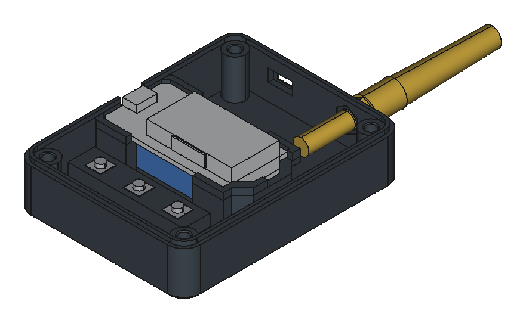
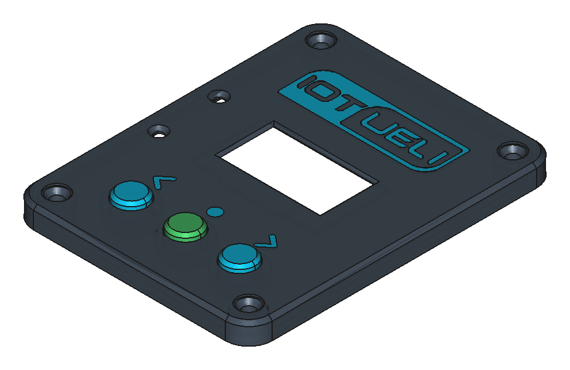

# 3-in-1 LoRaWAN (868 MHz) / WiFi / Bluetooth BLE Finder

<p align="center">
  <a href="https://www.iotueli.ch">
    
  </a>
</p>

<p align="center">
  <strong>Tragbarer 868 MHz LoRaWAN-Netzwerk-Scanner (Swisscom LPN, TTN, Dragino, Helium), 2.4 GHz WLAN-Scanner &amp; Bluetooth-BLE-Finder auf Basis des Heltec WiFi LoRa 32 V2 im maßgefertigten 2-Farben-3D-Druck-Gehäuse.</strong><br>
  Projekt &amp; IoT-Lösungen: <a href="https://www.iotueli.ch"><strong>www.iotueli.ch</strong></a> • <a href="Bauanleitung_LoRaWAN_Finder.pdf"><strong>Komplette Bau- &amp; Bedienungsanleitung (PDF, 4 Seiten A4)</strong></a>
</p>

---

## Gehäuse-Übersicht (Rev. 5 – 2-Farben-Edition für Bambu Lab)

| 2-Farben-Deckel (`IoTUeli`-Logo & Symbole) | Fertig montiertes Gerät | Explosionsansicht |
| :---: | :---: | :---: |
|  |  |  |
| **Abb. 1:** Deckel mit bündigem `0.60 mm` Zweifarb-Inlay (`66 × 86 × 23.2 mm`) | **Abb. 2:** Montierter 3-in-1 Finder mit 868-MHz-SMA-Antenne | **Abb. 3:** Alle Baugruppen & 3D-Druckteile im Überblick |

---

## Bambu Lab 3D-Druckdaten (`.3mf` & `.stl`)

Alle 3D-Druckdaten befinden sich direkt im Ordner [`cad/export/`](cad/export/) und sind **100 % stützfrei (`Support: AUS`)** konstruiert:

| Datei | Beschreibung & Farbzuweisung |
| :--- | :--- |
| **[`cad/export/LoraWanFinder_BambuLab_Platte.3mf`](cad/export/LoraWanFinder_BambuLab_Platte.3mf)** | **Komplette 2-Farben Bambu-Studio-Druckplatte** (alle Teile druckfertig orientiert, `0 %` Support, Filament 1 & Filament 2 bereits als Multi-Part-Objekt zugewiesen) |
| [`cad/export/Gehaeuse_Unten.stl`](cad/export/Gehaeuse_Unten.stl) | **Farbe 1:** Gehäuse-Unterteil mit `26 mm` breitem Kabel-Durchgang unter dem ESP32, vergrößertem `+8 mm` Antennenraum & verdrehsicherer SMA-Sechskantaufnahme |
| [`cad/export/Gehaeuse_Oben.stl`](cad/export/Gehaeuse_Oben.stl) | **Farbe 1:** Gehäusedeckel-Hauptkörper mit gestufter OLED-Tasche & `5.4 mm` Freiraum über den ESP32-Stiftleisten |
| [`cad/export/Logo_und_Tasten_Farbe2.stl`](cad/export/Logo_und_Tasten_Farbe2.stl) | **Farbe 2:** Bündiges `0.60 mm` Inlay für das **IoTUeli-Logo** oberhalb des Displays und die Tasten-Symbole `‹  ●  ›` |
| [`cad/export/Taster_Kappe.stl`](cad/export/Taster_Kappe.stl) | **Farbe 2:** `3×` drucken – Tasterkappen (Unterseite 100 % flach für vollen `1.65 mm` Tastenhub) |

> **Hinweis für Bambu Studio (AMS 2-Farben-Druck):**  
> Öffne einfach [`cad/export/LoraWanFinder_BambuLab_Platte.3mf`](cad/export/LoraWanFinder_BambuLab_Platte.3mf). Der Deckel (`Gehaeuse_Oben`) liegt mit der Sichtseite nach unten auf dem Druckbett und besteht bereits aus zwei Teilkörpern (`Deckel_Hauptkoerper` = **Filament 1** und `IoTUeli_Logo_und_Tasten` = **Filament 2**). Da das Inlay exakt `0.60 mm` hoch ist (`3 Schichten à 0.20 mm`), finden nur in den ersten 3 Schichten Farbwechsel statt.

---

## Stückliste (BOM)

| Anz. | Bauteil | Details / Einbaumaße |
| :---: | :--- | :--- |
| **1×** | **Heltec WiFi LoRa 32 V2** | `ESP32` (WiFi + BLE) + `SX1276` (868 MHz) + `0.96" OLED` (`52.0 × 25.33 mm`) |
| **1×** | **SMA-Buchse + Antenne** | `U.FL / IPEX` auf SMA-Einbaubuchse (`18 mm` Innentiefe) + `868 MHz` Antenne |
| **3×** | **Kurzhubtaster 6×6 mm** | 4-Pin Taster, Körper `6 × 6 × 2.9 mm` + Knopf `Ø 3.5 × 1.5 mm` (`4.4 mm` Bauhöhe) |
| **4×** | **M3 Einschmelzgewinde** | `Ø 4.0 mm` Außendurchmesser, Länge `4–6 mm` (Sackloch `7 mm` tief) |
| **4×** | **M3 × 8 mm Schrauben** | Zylinderkopf / Innensechskant (bündig versenkt im Deckel) |
| **1×** | **1S LiPo-Akku + Schalter** | Optional: `3.7 V LiPo` (`JST 1.25 mm`) + Mini-Schiebeschalter `SS12D00` |

---

## Elektrischer Anschluss & 4-Pin-Taster-Belegung

Die 3 Kurzhubtaster schalten gegen **`GND`** (interne Pull-Up-Widerstände im ESP32 sind aktiv). Pro `6 × 6 mm` Taster werden **nur 2 der 4 Pins** benötigt:

```
       ANSCHLUSS: GND                              FREI LASSEN
              │                                          │
              ▼                                          ▼
          ┌───────┐  ┌────────────────────────────┐  ┌───────┐
          │ PIN 1 ├──┤  Intern verbunden (1 ↔ 2)  ├──┤ PIN 2 │
          └───────┘  │                            │  └───────┘
                     │         ╭────────╮         │
                     │         │ TASTER │         │
                     │         ╰────────╯         │
          ┌───────┐  │                            │  ┌───────┐
          │ PIN 3 ├──┤  Intern verbunden (3 ↔ 4)  ├──┤ PIN 4 │
          └───────┘  └────────────────────────────┘  └───────┘
              ▲                                          ▲
              │                                          │
         FREI LASSEN                              GPIO 12 / 13 / 32
```

* **Der 100 %-sichere Diagonal-Trick:** Löte die zwei Drähte immer an **zwei diagonal gegenüberliegende Beinchen**:
  * **`Pin 1` (oben links)** -> **`GND`** (gemeinsame Masse für alle 3 Taster)
  * **`Pin 4` (unten rechts)** ->
    * **Taster LINKS `[ ‹ ]`:** `GPIO 12`
    * **Taster MITTE `[ ● ]`:** `GPIO 13`
    * **Taster RECHTS `[ › ]`:** `GPIO 32`
  * **`Pin 2` und `Pin 3`** bleiben frei.

---

## Schritt-für-Schritt Montage

| Schritt 1: Unterteil & Gewinde | Schritt 2: Taster & SMA-Antenne | Schritt 3: Heltec V2 & Kabelkanal | Schritt 4: Kappen & Deckel |
| :---: | :---: | :---: | :---: |
|  |  |  |  |
| `4× M3`-Einschmelzgewinde (`200–210 °C`) bündig in die Eck-Dome setzen | `3× Taster` (diagonal an Pin 1 & 4) und `SMA-Buchse` einsetzen | Drähte in den `26 mm` Durchgang unter dem ESP32 legen & `U.FL` aufklipsen | `3× Tasterkappen` in den Deckel stecken & mit `4× M3×8` verschrauben |

---

## Gebrauchserklärung: Die 5 Bildschirm-Seiten

Alle 5 Funktions-Seiten werden einheitlich mit den **3 Tastern** bedient (kein komplizierter Langdruck nötig):
* **Taster LINKS `[ ‹ ]` (`GPIO 12`):** Eine Seite zurückblättern (`1/5` -> `5/5` -> `4/5` -> `3/5` -> `2/5` -> `1/5`)
* **Taster RECHTS `[ › ]` (`GPIO 32`):** Eine Seite weiterblättern (`1/5` -> `2/5` -> `3/5` -> `4/5` -> `5/5`)
* **Taster MITTE `[ ● ]` (`GPIO 13`):** Führt immer genau die Aktion aus, die **unten in der Mitte in `[...]`** steht.

| Seite | OLED-Titel | Funktion & Anzeige | Taste MITTE `[ ● ]` |
| :---: | :--- | :--- | :--- |
| **1/5** | `1/5 LORA-CHECK` | Zeigt das zuletzt empfangene **echte 868-MHz-LoRa-Paket** in **Prozent (`0–100 %`)**, **`dBm`** und Alter (`vor 2s`) inkl. Bewertung (`SEHR GUT!`, `GUT (OK)`, `SCHWACH`, `RUHE`) | `[NEU MESSEN]`: Startet eine 3-Sekunden-Messung über alle Hauptkanäle |
| **2/5** | `2/5 LORA (n)` | Speichert **bis zu 10 verschiedene LoRaWAN-Netze & Sender** anhand von `DevAddr` / `DevEUI` (`SWISSCOM`, `TTN/DRAG`, `DRAGINO`, `HELIUM`, `LORIOT`, `PRIVAT`) samt `dBm` & `%` | `[NAECHSTES LORA]`: Blättert durch alle empfangenen LoRaWAN-Netze/Sender |
| **3/5** | `3/5 LORA-TEST` | **Aktiver Gateway-Sende-Test** für dein eigenes Dragino- oder TTN-Gateway | `[SENDEN!]`: Sendet 3 LoRaWAN-Testpakete (`DevAddr 2601CAFE`) auf `868.1 / 868.3 / 868.5 MHz` und horcht auf Gateway-Antwort |
| **4/5** | `4/5 WIFI (n)` | **2.4 GHz WLAN-Scanner:** Zeigt gefundene Anzahl, WLAN-Namen (`SSID`) und Signalbewertung in `%` | `[NAECHSTES WLAN]`: Blättert durch alle gefundenen WLANs und scannt am Ende neu |
| **5/5** | `5/5 BLE (n)` | **Bluetooth-BLE-Scanner:** Findet aktive BLE-Geräte (Sensoren, Beacons, Tracker) samt Name/MAC und Signalbewertung | `[NAECHSTES BLE]`: Blättert durch alle BLE-Geräte und scannt am Ende neu |

---

## Firmware kompilieren & flashen (PlatformIO)

```bash
# Projekt kompilieren
pio run

# Firmware per USB auf das Heltec WiFi LoRa 32 V2 flashen
pio run -t upload
```

---

## Dokumentation & Links

* **Vollständiges PDF-Handbuch (4 Seiten A4):** [`Bauanleitung_LoRaWAN_Finder.pdf`](Bauanleitung_LoRaWAN_Finder.pdf)
* **Webseite:** [https://www.iotueli.ch](https://www.iotueli.ch)
